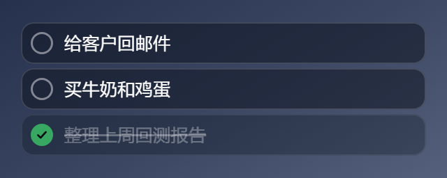
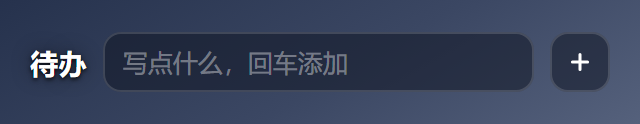
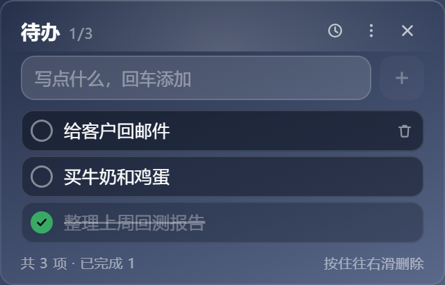
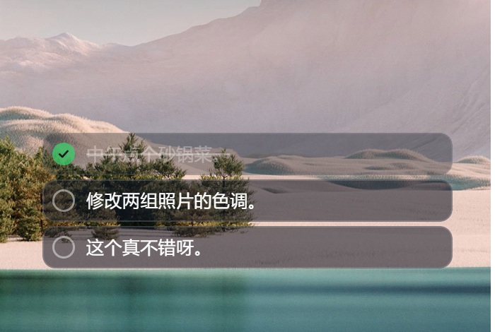
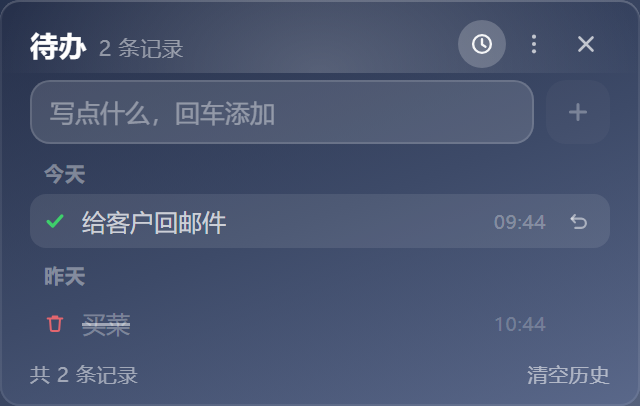

# 待办清单 · TodoCard

> 贴在 Windows 桌面上的待办小卡：平时只剩几条任务框，鼠标碰到才展开成完整卡片。
> 本项目原是「桌面卡片套件」（天气 + 待办合体，1.9.1 为最后合体版）里的待办卡片，现已拆分为独立应用，单独发布。

## 特性

- **平时只剩条目** —— 待办卡平时只显示待办本身：标题、历史/更多/关闭、输入框、底部统计全部收起，卡片真的变矮；鼠标移进卡片才展开，且展开时条目在屏幕上一动不动
- **连卡片底都没有** —— 收起时卡片背景、内高光、叠加色全部撤掉，窗口是真透明的，桌面上只剩几个圆角任务框；鼠标移进才长出卡片底色来托住顶栏和输入条
- **一条都没有时也是一行** —— 空列表不再是"还没有待办"的占位文案，而是把输入框本身摆成一条待办：`待办 + 写点什么 + ＋`，高度和一条待办完全一致，敲回车加第一条时窗口纹丝不动；**＋ 永远钉在最右端**
- **几条就多高** —— 窗口高度严格跟着条数走：1 条最矮，每多一条 +33px，删一条立刻缩回，不预留空位
- **打字完挪开就自动记下** —— 不用记得按回车：鼠标一离开卡片（0.3 秒内回来不算），输入框里的话就自己变成一条待办
- **双击就能改字** —— 写错了直接双击那条的文字，就地改；`Enter` 或点别处保存，`Esc` 反悔
- **拖窗口按顶栏** —— 顶栏就是这张卡的标题栏，按住它拖跟资源管理器一样；任务框不变抓手、不会抬起变形
- **拖动时只剩任务框** —— 一开始挪，卡片底、顶栏、输入条、页脚就淡出，桌面上只剩那几个框。挪的时候要看的是"这几个框跟别的窗口齐不齐"，一块卡片底垫在下面反而看不准。位置一个像素都没动，松手就原样长回来
- **中键也能拖** —— 不想去找那条 22px 的顶栏就按中键：按住卡片任意一处（正在打字的输入框除外）就能拖，同样保持透明。顺手把系统那个"中键自动滚动"圆圈也吃掉了
- **鼠标在框里就不会自己收** —— 收起只看一件事：系统光标有没有真的离开窗口矩形。展开时窗口会向上长，这时候浏览器会自己误判一次"鼠标走了"，以前就被它带着缩回去（连临时置顶一起撤掉，卡片沉到别的窗口后面）；现在那声误报不算数
- **鼠标指哪浮哪** —— 卡片被别的窗口压住时，鼠标指上去（不用点）就临时浮到最前，移开自动沉回去；不影响你设的「窗口置顶」
- **任何背景上都读得清** —— 卡片透明，但每个任务框/输入框自带一层深色玻璃，摆在白底的行情软件或 Word 前面也不会"看不见"
- **历史记录** —— 顶栏时钟图标进入历史视图，按今天/昨天/更早分组，看得到什么时候完成了什么、删掉了什么，误删可一键放回
- **不打扰** —— 默认不置顶、不占任务栏、不抢焦点，就安静待在桌面上
- **绿色免安装** —— 同时提供安装版（带开始菜单/桌面快捷方式）和单文件绿色版

## 下载安装

到 [Releases](../../releases) 页面下载：

| 文件 | 说明 |
| --- | --- |
| `TodoCard-1.0.1-x64-setup.exe` | 安装版。可选安装目录，自动创建快捷方式「待办清单」 |
| `TodoCard-1.0.1-x64-portable.exe` | 绿色版。双击即用，不写注册表（除自启动选项） |

> 未做代码签名，Windows SmartScreen 可能提示"未知发布者"，点「更多信息 → 仍要运行」即可。

> **从合体版升级**：首次启动会自动把合体版（1.9.1 及以前）记住的窗口位置和**全部待办内容、历史记录**搬过来，不用重新摆、也不用重录。

## 使用

平时只有条目（鼠标不在卡上，卡片背景本身也不画，桌面直接透出来）：



一条都没有时，整张卡就是那一行输入框：



鼠标移上去展开：



| 操作 | 效果 |
| --- | --- |
| 鼠标移进卡片 | 整张卡展开：标题、历史/更多/关闭、输入框、底部统计出现（窗口向上长，条目不动）；**光标真的离开窗口**才收回，只剩条目。同时这张卡会临时浮到最前面 |
| **按住顶栏拖** | 顶栏就是标题栏：按住「待办 0/2」那一行拖，整张卡跟着走，松手自动记住位置 |
| **按住中键拖** | 卡片任意一处都行（正在打字的输入框除外，那里中键还是粘贴）：按住就能挪。**两种拖法都会在拖动期间把卡片底和顶栏收起来**，只剩任务框，方便看对齐 |
| 输入文字 + `Enter` | 添加一条 |
| **输入完直接把鼠标挪开** | 有内容就自动加进去（挪开 0.3 秒内又回来则不算，可以接着打） |
| **双击某条的文字** | 就地改成别的字：`Enter` 或点别处保存，`Esc` 反悔；清空后回车视为放弃，不会把条目删掉 |
| 点左边圆圈 | 标记完成：文字划掉、整条变浅，**位置不动**（不会跳到底部） |
| 再点一次圆圈 | 取消完成 |
| 鼠标移到某条上 | 右侧浮出垃圾桶，点它删除 |
| 按住条目往右滑 | 滑过约 1/3 卡宽松手即删除；不到阈值会自动弹回 |
| 点顶栏时钟图标 | 切到历史记录视图，再点一次切回 |
| 历史里悬停某条 | 右侧浮出「↺ 放回待办」 |
| 页脚「清空历史」 | 清掉全部历史（不影响待办本身） |
| 右键卡片 | 菜单：添加待办 / 历史记录 / 清除已完成 / 桌面右键菜单显示 / 开机自启动 / 窗口置顶 / 退出 |
| `Ctrl`+`N` | 光标跳到输入框 |



**拖动的时候只剩任务框**：一开始挪，卡片底、顶栏、输入条、页脚就淡出，桌面上只剩那几条框 —— 挪位置时看的是"这几个框跟别的窗口齐不齐"，一块卡片底垫在下面反而看不准。

只撤皮肤不撤布局：顶栏/输入条/页脚用 `opacity` 淡出而不是 `display:none`，条目位置一个像素都不动。窗口高度也不改 —— 拖动中改高度会让系统重算拖动锚点，窗口会突然跳一下，所以宁可让上沿那块空着。松手后 0.3 秒内没再动就原样长回来。

**卡片高度就等于内容**：1 条待办时最矮，收起态就是一条的高度，鼠标移上去才展开；**每多一条正好长 33px**，少一条就缩回去；最多长到屏幕可用高度的 72%（再多的条目在卡片内部滚动）。如果卡片贴着屏幕底部，长高时会向上伸展、底边固定；条目减少后自动缩回你原来摆的位置。

**删除和完成都会留痕**：历史记录保留最近 120 条，按「今天 / 昨天 / 具体日期」分组，标出完成时间。删错了可以放回待办（一律回到未完成状态，免得立刻被「清除已完成」清走）。



数据存在渲染进程的 `localStorage` 里（待办 `todo_v1`、历史 `todo_hist_v1`），完全离线，不上传任何地方。

### 桌面右键菜单

在卡片上右键勾选「桌面右键菜单显示」后，**桌面空白处右键**会多出一项「显示待办卡片」，点一下就启动（已在运行则直接唤出，不会开第二个）。

- 只写 `HKCU\Software\Classes\DesktopBackground\Shell\TodoWidget`，不碰 HKLM、不需要管理员权限
- 注册表键名与天气卡片的 `WeatherWidget` 互不干扰，**两个应用都装也不冲突**
- 卸载安装版时自动清理这一项；取消勾选也会删掉
- Windows 11 的桌面右键是新版精简菜单，这一项在「显示更多选项」（或按 `Shift`+`F10`）里

### 关于"窗口置顶"

默认**不置顶**——卡片待在普通窗口层，切到别的程序时不会浮在最前面。如果你希望它一直在最上层，右键菜单勾选「窗口置顶」即可。

## 为什么不用系统磨砂（Acrylic）

它是透明窗口：系统 Acrylic 材质会铺满整个窗口矩形，页面再怎么透明也会被那层糊住，做不到"只剩几个任务框"。所以待办卡用 `transparent: true` + 页面自绘背景，展开时画渐变卡片、收起时什么都不画。

## 自己构建

```bash
git clone <repo-url>
cd todo-widget
npm install
npm start          # 开发运行
npm run dist       # 打包出 dist/ 下的 setup.exe 与 portable.exe
```

国内网络构建建议设镜像：

```bash
export ELECTRON_MIRROR="https://registry.npmmirror.com/-/binary/electron/"
export ELECTRON_BUILDER_BINARIES_MIRROR="https://registry.npmmirror.com/-/binary/electron-builder-binaries/"
```

## 目录结构

```
todo-widget/
├── main.js            # 主进程：窗口、光标监视、自动高度、拖动外观、位置记忆、合体版数据迁移
├── preload.js         # contextBridge 暴露的最小接口
├── todo.html          # 待办卡：全部界面与逻辑（单文件，无框架、无构建步骤，含右滑删除手势）
├── icon.png / icon.ico
└── tools/
    └── make-icon.py                # 多尺寸 ico 生成
```

## 已知限制

- 只在 Windows 上验证过
- 未做代码签名与自动更新
- 待办数据存在 `localStorage`，卸载时若勾选了删除应用数据会一并清空，建议重要事项别只记在这
- 卡片高度上限是屏幕可用高度的 72%，超过之后在卡片内部滚动（不无限长高，以免盖住整个桌面）
- **浅色壁纸下的可读性**：任务框/输入框自带深色玻璃底（`rgba(16,22,36,.55)` + 1px 亮边），白底前也能读。若整块桌面极亮且仍觉得偏弱，把 `todo.html` 里 `.item` / `.add input` 的背景透明度往上调（例如 `.72`）即可

## License

[MIT](LICENSE)

---

<sub>开发记录（对话过程、需求变更、AI 踩坑清单）→ [docs/DEVLOG.md](docs/DEVLOG.md)　·　本项目由 WorkBuddy + DeepSeek-V4.1-Flash 协作完成，此文档纯归档，与功能无关</sub>
